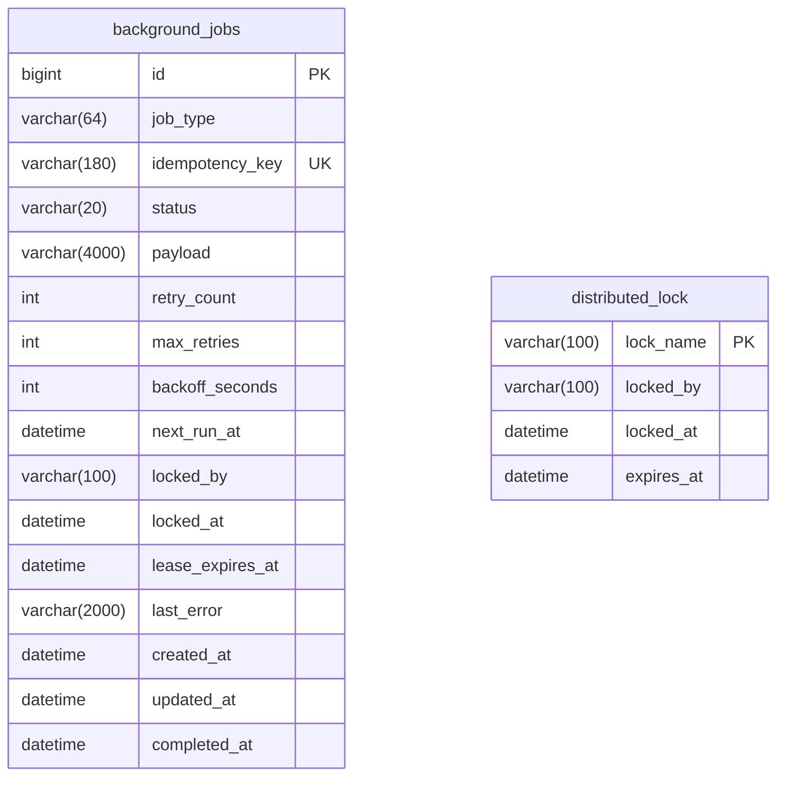

# Kiến trúc Tác vụ Nền, Retry và Khóa Phân tán (QLSV-93 / TASK-OP-06)

Tài liệu kỹ thuật đặc tả kiến trúc xử lý tác vụ nền (Background Jobs), cơ chế thử lại (Retry with Exponential Backoff), khóa phân tán chống chạy trùng (Distributed Lock) và cơ chế phục hồi tác vụ kẹt (Lease Timeout / Crash Recovery) trong hệ thống Quản lý Đào tạo QLSV, tích hợp toàn diện với Trung tâm Thông báo & Chuyển phát Email (TASK-OP-05 / QLSV-92).

---

## 1. Khảo sát & Quyết định Lựa chọn Hạ tầng (Infrastructure Architecture & Trade-offs)

### 1.1. Hiện trạng Hạ tầng Dự án
- **Cơ sở dữ liệu**: MySQL 8.4 (môi trường Docker và triển khai thực tế) và H2 in-memory (môi trường kiểm thử tự động CI / unit test / Playwright E2E).
- **Môi trường Docker / CI**: `docker-compose.yml` gồm 3 container (`mysql:8.4`, `qldt-backend`, `qldt-frontend`). Pipeline GitHub Actions (`ci.yml`) xây dựng backend qua Maven và chạy E2E Playwright. Hiện tại dự án **chưa cấu hình và chưa triển khai** các hệ thống message broker ngoài như Redis, RabbitMQ hay Apache Kafka.
- **Hệ thống định kỳ hiện hữu**: `NotificationReminderJob` và `AuditAnomalyService` đang sử dụng `@Scheduled` của Spring framework trong bộ nhớ (in-memory scheduler).

### 1.2. Đánh giá & So sánh Giải pháp

| Tiêu chí | Phương án A: In-Memory Scheduler thuần | Phương án B: Message Broker ngoài (Redis / RabbitMQ / Kafka) | Phương án C (Được chọn): DB-Backed Job Queue & Distributed Lease Engine |
| :--- | :--- | :--- | :--- |
| **Độ tin cậy khi Restart** | Kém (mất dữ liệu job đang chờ hoặc đang chạy) | Tốt (hỗ trợ persistence) | **Tuyệt đối** (lưu bền vững trong RDBMS, rollback/commit an toàn) |
| **Chống chạy trùng Multi-instance** | Không hỗ trợ (các instance đều kích hoạt cron trùng lặp) | Hỗ trợ tốt qua queue consumer group | **Hỗ trợ toàn diện** qua khóa phân tán nguyên tử (`distributed_lock` và conditional update) |
| **Phục hồi Worker Crash** | Không hỗ trợ | Cần dead-letter queue và heartbeat ngoài | **Hỗ trợ tự động** qua cơ chế Lease Expiration (`lease_timeout_seconds`) |
| **Tương thích Hạ tầng Hiện hữu** | 100% | Kém (phải thêm container, cấu hình mạng, sửa CI/CD, tăng chi phí) | **Hoàn hảo** (tận dụng MySQL 8.4 / JPA hiện có, không phụ thuộc dịch vụ ngoài) |
| **Đồng bộ Giao dịch Nghiệp vụ** | Không thể đồng bộ ACID | Phải dùng Outbox Pattern hoặc 2PC phức tạp | **Tự nhiên** (cùng schema DB, đăng ký tác vụ ngay trong transaction nghiệp vụ) |

### 1.3. Kết luận Lựa chọn & Trade-off
- **Quyết định**: Triển khai giải pháp **Database-Backed Persistent Job Queue & Atomic Distributed Lease/Lock Engine**.
- **Trade-off**:
  - *Ưu điểm*: Không phát sinh phụ thuộc mới, không cần sửa đổi hạ tầng deployment hay cụm CI, đảm bảo tính nhất quán dữ liệu cao nhất, chống trùng lặp tuyệt đối giữa các instance qua DB locking, dễ dàng sao lưu và kiểm toán.
  - *Đánh đổi*: Độ trễ tiếp nhận tác vụ phụ thuộc vào chu kỳ quét (`poll-interval-ms`, mặc định 5000ms). Với quy mô quản lý đào tạo đại học, chu kỳ 5 giây đáp ứng vượt trội mọi yêu cầu về thời gian thực và không gây áp lực tài nguyên DB.

---

## 2. Mô hình Dữ liệu Bền vững & Vòng đời Tác vụ

Hệ thống định nghĩa 4 trạng thái bền vững bắt buộc trong enum `BackgroundJobStatus`:
- `PENDING`: Tác vụ đã được ghi nhận bền vững vào DB, đang chờ worker tiếp nhận khi `next_run_at <= now`.
- `RUNNING`: Tác vụ đã được một worker cụ thể giành quyền thực thi độc quyền (acquired lease).
- `SUCCEEDED`: Tác vụ thực thi thành công, đã hoàn tất toàn bộ nghiệp vụ.
- `FAILED`: Tác vụ thất bại hoàn toàn sau khi đã thử lại hết số lần tối đa (`retry_count >= max_retries`), hoặc bị hủy bởi quản trị viên.

### Cấu trúc Bảng Cơ sở Dữ liệu



---

## 3. Chống Chạy Trùng & Tranh Chấp Lease Độc Quyền (Distributed Locking & Atomic Lease)

### 3.1. Tranh chấp Lease Tác vụ Hàng đợi (Atomic Lease Claim)
Khi nhiều worker hoặc nhiều instance chạy song song, việc tranh chấp tác vụ được thực thi bằng câu lệnh UPDATE có điều kiện nguyên tử ở tầng cơ sở dữ liệu:

```sql
UPDATE background_jobs
SET status = 'RUNNING',
    locked_by = :workerId,
    locked_at = :now,
    lease_expires_at = :leaseExpires,
    updated_at = :now
WHERE id = :id AND status = 'PENDING';
```
- Nếu câu lệnh trả về `updatedRows = 1`: Worker hiện tại đã giành được quyền thực thi độc quyền.
- Nếu câu lệnh trả về `updatedRows = 0`: Tác vụ đã được worker khác nhận trước, worker hiện tại an toàn bỏ qua.

### 3.2. Khóa Phân tán Cho Tác vụ Định kỳ (`distributed_lock`)
Đối với các tác vụ định kỳ kích hoạt theo cron (`remindClosingRegistrationWindows`, `retryFailedEmails`), `DistributedLockService` đảm bảo chỉ duy nhất một instance trong cụm được phép thực thi:
- Hàm `executeWithLock(String lockName, Duration ttl, Runnable task)`: Thử xin khóa qua INSERT/UPDATE có kiểm tra `expires_at`.
- Nếu khóa đang còn hiệu lực: Instance khác bỏ qua, không chạy trùng lặp.
- Khi tác vụ chạy xong: Tự động giải phóng khóa ngay lập tức.

---

## 4. Phục hồi Tác vụ Kẹt Khi Worker Restart (Crash Recovery & Lease Timeout)

- Nếu một worker đang thực thi một tác vụ (`status = 'RUNNING'`) mà tiến trình bị dừng đột ngột (SIGKILL, mất điện, OutOfMemory, khởi động lại container):
  - Tác vụ sẽ không bị mất dữ liệu vì đã được lưu bền vững trong bảng `background_jobs`.
  - Hạn quyền sử dụng lease được ghi nhận tại cột `lease_expires_at = now + leaseTimeoutSeconds` (mặc định 300s).
- Trong mỗi chu kỳ quét, worker tự động chạy quy trình phục hồi `recoverStuckJobs()`:
  - Quét các tác vụ có `status = 'RUNNING'` và `lease_expires_at <= now`.
  - Tăng `retry_count = retry_count + 1`.
  - Nếu `retry_count < max_retries`: Phục hồi tác vụ về trạng thái `PENDING`, tính toán lại thời gian `next_run_at` theo exponential backoff, xóa thông tin worker cũ để worker khác nhận lại.
  - Nếu `retry_count >= max_retries`: Chuyển trạng thái sang `FAILED` kèm thông điệp cảnh báo quá hạn lease và hết lượt retry.

---

## 5. Chiến lược Retry, Exponential Backoff & Khử Nhạy Cảm Lỗi (Secret Sanitization)

### 5.1. Công thức Exponential Backoff
Hệ thống tính toán khoảng thời gian chờ thử lại tự động theo công thức:
$$\text{delay} = \min\left(\text{baseBackoffSeconds} \times \text{backoffMultiplier}^{(\text{retryCount} - 1)}, \text{maxBackoffSeconds}\right)$$

Ví dụ với cấu hình mặc định (cơ sở 30s, hệ số 2.0, tối đa 3600s):
- Lần thử 1 (sau lần lỗi đầu tiên): $30 \times 2^0 = 30$ giây.
- Lần thử 2: $30 \times 2^1 = 60$ giây.
- Lần thử 3: $30 \times 2^2 = 120$ giây.

### 5.2. Khử Nhạy Cảm Lỗi (Secret Sanitization)
Lớp `SecretSanitizer` lọc và che giấu toàn bộ thông tin nhạy cảm trước khi ghi nhận vào cột `last_error` hoặc hệ thống log:
- Mật khẩu & khóa bí mật: `password=***REDACTED***`, `secret=***REDACTED***`.
- Bearer tokens: `Bearer ***REDACTED***`.
- Chuỗi JWT: `***JWT_REDACTED***`.
- Thông tin xác thực DB: `jdbc:...://user:***REDACTED***@...`.
- Cắt gọn chuỗi lỗi tối đa 2000 ký tự để chống tràn cột cơ sở dữ liệu.

---

## 6. Tính Idempotent & Tích hợp Nghiệp vụ TASK-OP-05

- **Idempotent Enqueue**: Cột `idempotency_key` được bảo vệ bằng Unique Constraint `uk_background_jobs_idempotency_key`. Khi gọi hàm `enqueue` với cùng một key:
  - Nếu tác vụ đã tồn tại ở trạng thái `PENDING`, `RUNNING` hoặc `SUCCEEDED`, hệ thống trả về bản ghi hiện có, tuyệt đối không tạo bản ghi mới.
- **Tích hợp TASK-OP-05**:
  - `EmailRetryJobHandler` (`EMAIL_RETRY_BATCH`) và `EmailDispatchJobHandler` (`EMAIL_DELIVERY`) tích hợp trực tiếp với `EmailDeliveryService`.
  - Bảng `email_delivery` đã có ràng buộc chống trùng lặp `uk_email_delivery_recipient_event` và logic kiểm tra `existsByRecipientIdAndIdempotencyKey`. Do đó, kể cả khi worker restart hoặc chạy lại cùng một job, nghiệp vụ gửi email và trừ quota/thông báo không bao giờ bị nhân đôi.

---

## 7. Múi Giờ Thống Nhất (Timezone Standardization)

- Toàn bộ các mốc thời gian lên lịch `next_run_at`, kiểm tra thời hạn lease `lease_expires_at`, thời gian khóa `locked_at`, nhắc nhở đợt đăng ký và dọn dẹp dữ liệu đều quy chuẩn theo múi giờ **`Asia/Ho_Chi_Minh`** (GMT+7).
- Cấu hình qua tham số `app.background-jobs.timezone: Asia/Ho_Chi_Minh` và đồng bộ với biến môi trường `BACKGROUND_JOBS_TIMEZONE`.

---

## 8. Giao diện Vận hành & Phân quyền Bảo mật (Operational Monitoring REST API)

Toàn bộ các endpoint vận hành tác vụ nền được đặt tại `/api/admin/background-jobs` và bảo vệ nghiêm ngặt bằng vai trò `@PreAuthorize("hasRole('QUAN_TRI')")`:
- Người dùng chưa đăng nhập: Trả về HTTP `401 Unauthorized`.
- Người dùng có vai trò `SINH_VIEN` hoặc `GIANG_VIEN`: Trả về HTTP `403 Forbidden`.
- Chỉ người dùng có vai trò `QUAN_TRI` mới có quyền truy cập:
  - `GET /api/admin/background-jobs?status=&jobType=&page=&size=`: Tra cứu danh sách tác vụ phân trang.
  - `GET /api/admin/background-jobs/{id}`: Tra cứu chi tiết tác vụ (bao gồm payload đã khử nhạy cảm và thông báo lỗi).
  - `GET /api/admin/background-jobs/stats`: Báo cáo thống kê tổng hợp số lượng job (`pending`, `running`, `succeeded`, `failed`, `total`).
  - `POST /api/admin/background-jobs/{id}/retry`: Kích hoạt thử lại thủ công một tác vụ `FAILED`.
  - `POST /api/admin/background-jobs/{id}/cancel`: Hủy một tác vụ `PENDING` hoặc `FAILED`.

---

## 9. Tham số Cấu hình Tập trung

Tất cả các tham số được khai báo tập trung trong `application.yml` tại nhánh `app.background-jobs`:

| Tham số cấu hình | Biến môi trường | Mặc định | Ý nghĩa |
| :--- | :--- | :---: | :--- |
| `enabled` | `BACKGROUND_JOBS_ENABLED` | `true` | Bật/tắt tiến trình worker nền |
| `worker-id` | `BACKGROUND_JOBS_WORKER_ID` | Hostname + UUID | Định danh duy nhất của worker |
| `poll-interval-ms` | `BACKGROUND_JOBS_POLL_INTERVAL_MS` | `5000` | Chu kỳ quét hàng đợi (mili-giây) |
| `default-max-retries` | `BACKGROUND_JOBS_DEFAULT_MAX_RETRIES` | `3` | Số lần thử lại tối đa |
| `default-backoff-seconds` | `BACKGROUND_JOBS_DEFAULT_BACKOFF_SECONDS` | `30` | Thời gian chờ thử lại cơ sở (giây) |
| `backoff-multiplier` | `BACKGROUND_JOBS_BACKOFF_MULTIPLIER` | `2.0` | Hệ số nhân exponential backoff |
| `max-backoff-seconds` | `BACKGROUND_JOBS_MAX_BACKOFF_SECONDS` | `3600` | Thời gian chờ tối đa (giây) |
| `lease-timeout-seconds` | `BACKGROUND_JOBS_LEASE_TIMEOUT_SECONDS` | `300` | Thời hạn lease trước khi coi là worker bị kẹt (5 phút) |
| `batch-size` | `BACKGROUND_JOBS_BATCH_SIZE` | `10` | Số tác vụ tối đa nhận mỗi đợt quét |
| `timezone` | `BACKGROUND_JOBS_TIMEZONE` | `Asia/Ho_Chi_Minh` | Múi giờ chuẩn hóa hệ thống |
| `retention-days` | `BACKGROUND_JOBS_RETENTION_DAYS` | `30` | Thời gian lưu trữ tác vụ đã hoàn tất |
