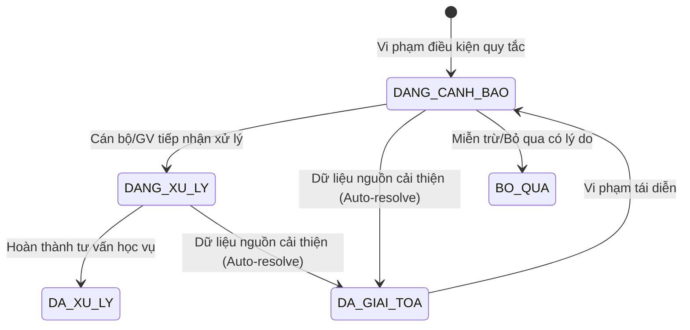

# Báo cáo Kỹ thuật & Nghiệp vụ: Hệ thống Cảnh báo Học tập Sớm theo Quy tắc (Early Warning)
**Mã nghiệp vụ:** QLSV-97 — TASK-OP-10  
**Trạng thái pháp lý quy chế:** Dự kiến (Chờ Hội đồng Đào tạo & Ban Giám hiệu phê duyệt chính thức)  
**Nguyên tắc cốt lõi:** Minh bạch, 100% giải thích được, KHÔNG dùng mô hình dự đoán hộp đen, An toàn tuyệt đối không sửa dữ liệu nghiệp vụ/trạng thái sinh viên.

---

## 1. Bối cảnh & Mục tiêu Nghiệp vụ

Hệ thống Quản lý Đào tạo QLSV cần phát hiện sớm các nguy cơ học tập của sinh viên (nguy cơ trượt học phần, nguy cơ cấm thi do vắng nhiều, xu hướng suy giảm học lực, chậm tiến độ tích lũy tín chỉ) để kịp thời hỗ trợ, tư vấn và can thiệp học vụ.

### Các nguyên tắc an toàn bắt buộc:
1. **Không dùng mô hình dự đoán hộp đen (Black-box AI / Machine Learning)**: Toàn bộ cảnh báo đều kích hoạt trên các luật điều kiện xác thực từ dữ liệu quan hệ có thật (điểm quá trình, điểm danh buổi học, GPA học kỳ đã công bố, tín chỉ tích lũy).
2. **Minh bạch & Có thể giải thích (Explainable by Design)**: Mỗi cảnh báo phải chỉ rõ luật vi phạm, công thức tính toán, dữ liệu dẫn chứng cụ thể (snapshot JSON) và ngưỡng đối chiếu.
3. **An toàn dữ liệu học vụ (Non-invasive Safe Default)**:
   - Cảnh báo **tuyệt đối KHÔNG tự động thay đổi trạng thái học tập** của sinh viên (`Student.trangThaiHocTap` vẫn bảo lưu: `DANG_HOC`, `BAO_LUU`,...).
   - **KHÔNG khóa hoặc vô hiệu hóa tài khoản người dùng** (`User.trangThai`).
   - **KHÔNG tự ý sửa điểm, hủy đăng ký học phần** hay biến đổi bất kỳ dữ liệu gốc nào.
4. **Cơ chế Idempotency & Chống trùng lặp**: Khóa tổng hợp duy nhất `khoaChongTrung = "sv:{sinhVienId}#{maLuat}#{nguCanh}"`. Quét lại nhiều lần không sinh bản ghi trùng.
5. **Cập nhật & Đóng có lưu vết (Traceable Lifecycle)**: Khi sinh viên cải thiện dữ liệu nguồn (điểm quá trình được sửa nâng lên, bổ sung buổi điểm danh, hoàn thành tín chỉ bù đắp), hệ thống tự động giải tỏa cảnh báo (`DA_GIAI_TOA`, `active = false`) kèm nguyên nhân giải tỏa và ghi Audit Log.
6. **Kiểm soát phân quyền & Quyền riêng tư sinh viên**:
   - `QUAN_TRI`: Xem toàn trường, quét toàn trường, cập nhật trạng thái xử lý (`DANG_XU_LY`, `DA_XU_LY`, `BO_QUA`) với ghi chú.
   - `GIANG_VIEN`: Xem cảnh báo của sinh viên thuộc các lớp mình trực tiếp phụ trách, ghi nhận tư vấn học vụ.
   - `SINH_VIEN`: Chỉ xem cảnh báo của chính mình VÀ chỉ xem các loại cảnh báo được cờ `choPhepSinhVienXem = true` cho phép.

---

## 2. Đặc tả 4 Nhóm Luật Cảnh Báo Sớm Minh Bạch

| STT | Nhóm luật | Mã luật (`maLuat`) | Công thức kiểm tra | Nguồn dẫn chứng | Mức độ | Hiển thị SV | Trạng thái chốt quy chế |
|:---:|---|---|---|---|:---:|:---:|:---:|
| 1 | **Điểm quá trình thấp** | `RULE_MIDTERM_LOW` | `diemQuaTrinh < nguongDiem` (5.0/10) | `Grade.diemQuaTrinh` của lớp học phần đang học | `CANH_BAO` | Cho phép xem | ⚠️ Chờ Hội đồng xác nhận giữa 4.0 hay 5.0 |
| 2 | **Vắng học quá ngưỡng** | `RULE_ATTENDANCE_EXCESSIVE` | `soBuoiVang >= 3` hoặc `tyLeVang >= 20.0%` | `AttendanceRecord` & `ClassSession` hợp lệ | `NGHIEM_TRONG` | Cho phép xem | ⚠️ Chờ xác nhận số buổi tuyệt đối hay tỷ lệ % |
| 3 | **GPA giảm liên tiếp** | `RULE_GPA_DECLINE` | `(gpaKyTruoc - gpaKySau) >= 0.3` (qua 2 kỳ) | `Semester` & `Grade` đã công bố | `CANH_BAO` | **Ẩn với SV** (chỉ Cố vấn/Admin) | ⚠️ Chờ chốt chính sách riêng tư cho SV |
| 4 | **Thiếu tiến độ tín chỉ** | `RULE_CREDIT_DEFICIT` | `tinChiThieu >= 8` hoặc `tyLeHoanThanh < 70%` | `tinChiTichLuy` vs `soKy * 14 TC` chuẩn | `CANH_BAO` | Cho phép xem | ⚠️ Chờ chốt tiến độ chuẩn 14 TC/kỳ |

---

### Chi tiết cách tính từng luật

#### Luật 1: Điểm quá trình thấp hơn ngưỡng (`RULE_MIDTERM_LOW`)
- **Đối tượng xét**: Các học phần sinh viên đang theo học (`RegistrationStatus.DA_DANG_KY`) đã có điểm quá trình do giảng viên nhập nhưng chưa kết thúc hoặc có nguy cơ cao.
- **Công thức**: `diemQuaTrinh < nguongDiemQuaTrinh` (cấu hình mặc định: `5.0`).
- **Dữ liệu dẫn chứng snapshot**:
  ```json
  {
    "sinhVienId": 1,
    "maSinhVien": "SV001",
    "hoTenSinhVien": "Nguyễn Văn A",
    "lopHocPhanId": 101,
    "maLop": "CS101-01",
    "maMon": "CS101",
    "tenMon": "Lập trình cơ sở",
    "diemQuaTrinh": 3.5,
    "nguongDiem": 5.0,
    "thangDiem": 10.0,
    "thoiDiemDanhGia": "2026-11-10T01:50:00"
  }
  ```
- **Giải trình minh bạch**: Điểm quá trình chiếm tỷ trọng lớn trong cơ cấu điểm học phần. Điểm 3.5/10.0 thấp hơn chuẩn đạt 5.0/10.0, khiến sinh viên đứng trước nguy cơ trượt học phần nếu không cải thiện bài thi cuối kỳ.

#### Luật 2: Số buổi hoặc tỷ lệ vắng vượt ngưỡng (`RULE_ATTENDANCE_EXCESSIVE`)
- **Đối tượng xét**: Điểm danh thực tế các buổi học đã diễn ra (`ngayHoc <= today`) và loại trừ các ngày nghỉ thông báo (`ClassAbsenceNotice`).
- **Công thức**:
  - `tongBuoiHopLe = count(buoiHoc da dien ra khong nghi)`
  - `soBuoiVang = count(diem danh VANG)`
  - `tyLeVang = (soBuoiVang / tongBuoiHopLe) * 100%`
  - Điều kiện kích hoạt: `soBuoiVang >= nguongSoBuoiVang` (3 buổi) HOẶC (`tongBuoiHopLe >= 3` VÀ `tyLeVang >= nguongTyLeVang` (20.0%)).
- **Dữ liệu dẫn chứng snapshot**:
  ```json
  {
    "sinhVienId": 1,
    "maSinhVien": "SV001",
    "lopHocPhanId": 102,
    "maLop": "MATH101-01",
    "tenMon": "Giải tích 1",
    "soBuoiVang": 3,
    "tongBuoiHopLe": 10,
    "tyLeVang": 30.0,
    "nguongSoBuoiVang": 3,
    "nguongTyLeVang": 20.0,
    "thoiDiemDanhGia": "2026-11-10T01:50:00"
  }
  ```

#### Luật 3: GPA giảm qua các học kỳ liên tiếp (`RULE_GPA_DECLINE`)
- **Đối tượng xét**: Lịch sử điểm tổng kết học phần chính thức đã công bố (`bangDiemDaCongBo == true` và `diemTongKet != null`).
- **Thời gian cửa sổ**: 2 học kỳ liên tiếp có kết quả (`soHocKyLienTiep = 2`).
- **Công thức**: `gpaHe4[ky_i] - gpaHe4[ky_i+1] >= mucGiamToiThieu` (mặc định: `0.30` điểm hệ 4).
- **Chính sách riêng tư (Privacy Guard)**: `choPhepSinhVienXem = false`. Nhằm tránh gây áp lực tâm lý tiêu cực cho sinh viên, cảnh báo này mặc định chỉ hiển thị cho Cố vấn học tập và Ban Đào tạo để chủ động liên hệ hỗ trợ phương pháp học tập.

#### Luật 4: Thiếu tín chỉ so với tiến độ học tập (`RULE_CREDIT_DEFICIT`)
- **Đối tượng xét**: Toàn bộ tín chỉ tích lũy đạt (`diemTongKet >= 5.0`, mỗi môn tính một lần) so với số học kỳ đã học.
- **Công thức**:
  - `soKyDaHoc = count(distinct hocKy da dang ky)`
  - `tinChiKyVong = soKyDaHoc * tinChiChuanMoiKy` (mặc định: 14 TC/kỳ)
  - `tinChiThieu = max(0, tinChiKyVong - tinChiTichLuy)`
  - `tyLeHoanThanh = (tinChiTichLuy / tinChiKyVong) * 100%`
  - Điều kiện: `tinChiThieu >= nguongTinChiThieu` (8 TC) HOẶC (`soKyDaHoc >= 2` VÀ `tyLeHoanThanh < 70.0%`).

---

## 3. Kiến trúc Chống trùng & Cập nhật / Đóng có Lưu vết



- **Khóa chống trùng**: `khoa_chong_trung = sv:{sinhVienId}#{maLuat}#{nguCanh}`.
- **Ràng buộc Database**: `UNIQUE CONSTRAINT uk_canh_bao_sv_luat_ngucanh` trên cột `khoa_chong_trung`.
- **Tự động giải tỏa có truy vết**: Khi chạy quét lại, nếu điều kiện không còn thỏa mãn:
  - Bản ghi chuyển sang `DA_GIAI_TOA`.
  - Cập nhật `nguyenNhanGiaiToa = "..."` và `ngayXuLy = LocalDateTime.now()`.
  - Ghi bản ghi Audit Log: `ACADEMIC_ALERT_AUTO_RESOLVED`.

---

## 4. Cấu hình Tập trung & Danh mục Tham số Chờ Phê duyệt

Toàn bộ cấu hình được định nghĩa tại `application.yml` (`app.early-warning`) và nạp vào bean `EarlyWarningProperties`:

```yaml
app:
  early-warning:
    enabled: ${EARLY_WARNING_ENABLED:true}
    official-regulation: ${EARLY_WARNING_OFFICIAL_REGULATION:false}
    policy-note: "Các ngưỡng cảnh báo học tập sớm và chính sách quyền riêng tư đang áp dụng cấu hình tập trung dự kiến, chờ Hội đồng Đào tạo / Chủ dự án phê duyệt chính thức."
    diem-qua-trinh:
      enabled: ${EARLY_WARNING_DIEM_QT_ENABLED:true}
      nguong-diem: ${EARLY_WARNING_DIEM_QT_NGUONG:5.0}
      muc-do: ${EARLY_WARNING_DIEM_QT_MUC_DO:CANH_BAO}
      cho-phep-sinh-vien-xem: ${EARLY_WARNING_DIEM_QT_SV_XEM:true}
      ghi-chu: "Cần xác nhận ngưỡng điểm quá trình chính thức giữa mức 4.0 (nguy cơ rớt môn) và 5.0 (dưới chuẩn đạt)."
    diem-danh:
      enabled: ${EARLY_WARNING_DIEM_DANH_ENABLED:true}
      nguong-so-buoi-vang: ${EARLY_WARNING_DIEM_DANH_SO_BUOI:3}
      nguong-ty-le-vang: ${EARLY_WARNING_DIEM_DANH_TY_LE:20.0}
      muc-do: ${EARLY_WARNING_DIEM_DANH_MUC_DO:NGHIEM_TRONG}
      cho-phep-sinh-vien-xem: ${EARLY_WARNING_DIEM_DANH_SV_XEM:true}
      ghi-chu: "Cần xác nhận ngưỡng số buổi vắng tuyệt đối hay tỷ lệ vắng phần trăm để kích hoạt cảnh báo/cấm thi chính thức."
    gpa-giam:
      enabled: ${EARLY_WARNING_GPA_GIAM_ENABLED:true}
      so-hoc-ky-lien-tiep: ${EARLY_WARNING_GPA_GIAM_SO_KY:2}
      muc-giam-toi-thieu: ${EARLY_WARNING_GPA_GIAM_MUC_GIAM:0.3}
      muc-do: ${EARLY_WARNING_GPA_GIAM_MUC_DO:CANH_BAO}
      cho-phep-sinh-vien-xem: ${EARLY_WARNING_GPA_GIAM_SV_XEM:false}
      ghi-chu: "Chính sách riêng tư: cảnh báo suy giảm GPA hiện chỉ mở cho Cán bộ Quản trị và Cố vấn học tập; chờ quyết định chính thức về việc hiển thị trực tiếp cho Sinh viên."
    tien-do-tin-chi:
      enabled: ${EARLY_WARNING_TIEN_DO_ENABLED:true}
      tin-chi-chuan-moi-ky: ${EARLY_WARNING_TIEN_DO_TC_CHUAN:14}
      nguong-tin-chi-thieu: ${EARLY_WARNING_TIEN_DO_TC_THIEU:8}
      nguong-ty-le-hoan-thanh: ${EARLY_WARNING_TIEN_DO_TY_LE:70.0}
      muc-do: ${EARLY_WARNING_TIEN_DO_MUC_DO:CANH_BAO}
      cho-phep-sinh-vien-xem: ${EARLY_WARNING_TIEN_DO_SV_XEM:true}
      ghi-chu: "Cần xác nhận tiến độ chuẩn 14 tín chỉ/kỳ và ngưỡng thiếu 8 tín chỉ có áp dụng chung toàn trường hay phân theo ngành/khóa."
```

### Danh mục các điểm chờ xác nhận:
1. [ ] **Quy chế chính thức về Hệ thống Cảnh báo Sớm**: Hiện tại `officialRegulation = false`.
2. [ ] **Ngưỡng điểm quá trình**: Chọn mức 4.0 (báo động đỏ nguy cơ rớt môn) hay 5.0 (dưới chuẩn đạt học phần).
3. [ ] **Tiêu chuẩn cấm thi chuyên cần**: Số buổi tuyệt đối (>= 3 buổi) hay tỷ lệ phần trăm (>= 20%).
4. [ ] **Chính sách riêng tư hiển thị GPA giảm**: Quyết định có cho sinh viên xem cảnh báo suy giảm GPA hay chỉ dùng nội bộ cho Cố vấn học tập.
5. [ ] **Tiến độ chuẩn tích lũy tín chỉ**: Thống nhất chuẩn 14 tín chỉ/học kỳ hay phân cấp theo CTĐT từng ngành.

---

## 5. Danh mục REST API

| Method | Endpoint | Quyền hạn | Mô tả |
|:---:|---|:---:|---|
| `GET` | `/api/admin/canh-bao-hoc-tap` | `QUAN_TRI` | Lọc và phân trang toàn bộ cảnh báo sớm toàn trường |
| `GET` | `/api/admin/canh-bao-hoc-tap/{id}` | `QUAN_TRI` | Xem chi tiết cảnh báo, công thức giải thích và snapshot |
| `POST` | `/api/admin/canh-bao-hoc-tap/quet-du-lieu` | `QUAN_TRI` | Kích hoạt quét và đánh giá toàn trường theo quy tắc |
| `PATCH` | `/api/admin/canh-bao-hoc-tap/{id}/xu-ly` | `QUAN_TRI` | Đánh dấu trạng thái xử lý (`DANG_XU_LY`, `DA_XU_LY`, `BO_QUA`) |
| `GET` | `/api/admin/canh-bao-hoc-tap/cau-hinh` | `QUAN_TRI` | Tra cứu cấu hình tập trung, 4 quy tắc và tham số chờ duyệt |
| `GET` | `/api/giang-vien/canh-bao-hoc-tap` | `GIANG_VIEN`, `QUAN_TRI` | Xem cảnh báo của sinh viên trong các lớp mình phụ trách |
| `PATCH` | `/api/giang-vien/canh-bao-hoc-tap/{id}/xu-ly` | `GIANG_VIEN`, `QUAN_TRI` | Giảng viên ghi nhận tư vấn học vụ / đang xử lý |
| `GET` | `/api/sinh-vien/me/canh-bao-hoc-tap` | `SINH_VIEN` | Sinh viên tự xem các cảnh báo được chính sách cho phép xem |
| `GET` | `/api/sinh-vien/me/canh-bao-hoc-vu` | `SINH_VIEN` | Alias chuẩn hóa theo ma trận phân quyền hệ thống |
| `GET` | `/api/sinh-vien/me/canh-bao-hoc-tap/tom-tat` | `SINH_VIEN` | Tóm tắt nhanh số lượng cảnh báo đang hoạt động |
| `GET` | `/api/sinh-vien/me/canh-bao-hoc-tap/{id}` | `SINH_VIEN` | Chi tiết cảnh báo của chính mình |
