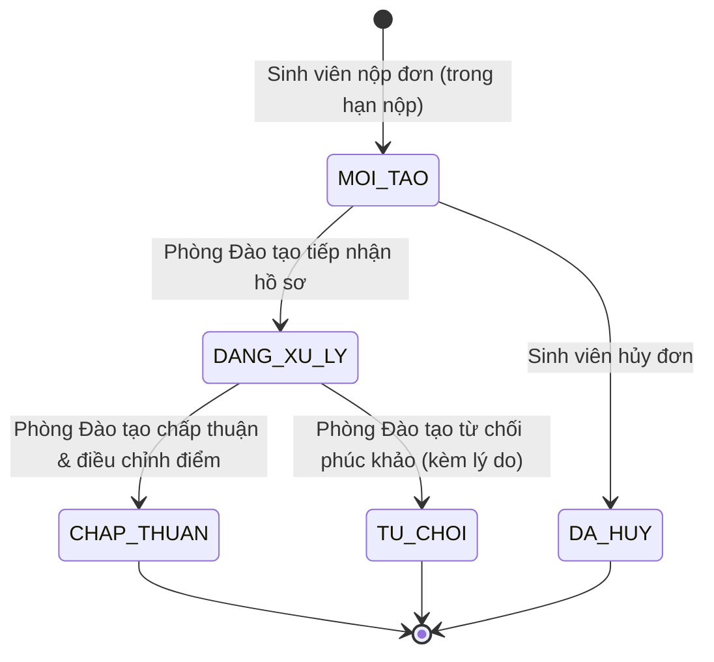

# Quản lý Duyệt, Khóa và Phúc khảo Điểm (QLSV-85 / TASK-AD-10)

Tài liệu kỹ thuật tổng hợp quy trình quản lý phê duyệt, khóa bảng điểm và luồng phúc khảo điểm trong hệ thống Quản lý Đào tạo, tích hợp toàn diện với máy trạng thái QLSV-74, hệ thống thông báo QLSV-65 và nhật ký kiểm toán (Audit Log).

---

## 1. Tổng quan & Phạm vi thực hiện

Nhiệm vụ **QLSV-85 — TASK-AD-10** tập trung vào 2 trụ cột nghiệp vụ:
1. **Quản trị duyệt, trả về, công bố và khóa bảng điểm**:
   - Giao diện quản trị tập trung hiển thị danh sách lớp học phần theo học kỳ, giảng viên và trạng thái bảng điểm (`NHAP`, `CHO_DUYET`, `DA_DUYET`, `DA_CONG_BO`, `DA_KHOA`, `TRA_VE`).
   - Tích hợp 100% với máy trạng thái chuẩn của `QLSV-74`; **không tạo luồng duyệt thứ hai** hoặc bypass kiểm tra quyền.
   - Chặn duyệt khi lớp chưa đủ 100% điểm hợp lệ; trả về chỉnh sửa bắt buộc có lý do.
   - Sau khi khóa (`DA_KHOA`), chặn toàn bộ API nhập/sửa/import điểm ở backend.
   - Sinh viên chỉ xem được điểm sau khi công bố; thông báo được phát sau khi giao dịch commit thành công.
2. **Quy trình phúc khảo điểm (Grade Appeals)**:
   - Sinh viên nộp đơn phúc khảo trực tuyến cho các môn đã công bố điểm trong khung thời gian quy định (`hanNop`).
   - Phòng Đào tạo (`QUAN_TRI`) tiếp nhận, xử lý, chấp thuận điều chỉnh hoặc từ chối phúc khảo.
   - **Bảo toàn dữ liệu**: Không bao giờ sửa âm thầm điểm gốc; lưu snapshot điểm gốc bất biến trên đơn phúc khảo.
   - Khi chấp thuận điều chỉnh, hệ thống chuyển qua luồng điều chỉnh điểm phúc khảo chuyên biệt (`dieuChinhDiemPhucKhao`) có ghi nhận kiểm toán (audit log) đầy đủ điểm trước và sau điều chỉnh.
   - Cơ chế cấu hình thời hạn nộp và quy chế tập trung (`app.grade-appeal`), tách bạch rõ ràng phần quy chế chính thức chưa chốt của nhà trường.

---

## 2. Máy trạng thái bảng điểm & Kiểm soát quyền (QLSV-74 Integration)

### 2.1. Ma trận trạng thái bảng điểm (`GradeSheetStatus`)

| Trạng thái | Hiển thị | Cho phép giảng viên sửa/import | Sinh viên xem điểm | Đã khóa cứng | Ghi chú nghiệp vụ |
|---|---|---|---|---|---|
| `NHAP` | Bản nháp | **Có** | Không | Không | Giảng viên nhập điểm sơ bộ hoặc import excel. |
| `CHO_DUYET` | Chờ duyệt | Không | Không | Không | Giảng viên gửi duyệt sau khi đã nhập đủ 100% điểm. |
| `TRA_VE` | Trả về sửa | **Có** | Không | Không | Phòng Đào tạo trả về kèm lý do bắt buộc để sửa. |
| `DA_DUYET` | Đã duyệt | Không | Không | Không | Phòng Đào tạo duyệt, sẵn sàng công bố hoặc khóa. |
| `DA_CONG_BO` | Đã công bố | Không | **Có** | Không | Đã công bố cho sinh viên; sinh viên có thể phúc khảo. |
| `DA_KHOA` | Đã khóa | Không | **Có** | **Có** | Khóa sổ học kỳ. Toàn bộ API nhập/sửa bị chặn backend. |

### 2.2. Kiểm tra điều kiện tiên quyết khi duyệt điểm
- Khi Quản trị viên gọi API duyệt bảng điểm (`POST /api/admin/lop-hoc-phan/{id}/phe-duyet-diem`):
  1. Kiểm tra quyền `Role.QUAN_TRI` (403 Forbidden nếu không đúng vai trò).
  2. Khóa dòng dữ liệu `CourseClass` với `PESSIMISTIC_WRITE` (chống race condition).
  3. Kiểm tra trạng thái hiện tại phải là `CHO_DUYET` (409 Conflict nếu khác).
  4. Kiểm tra điều kiện bắt buộc: Lớp phải có ít nhất 1 sinh viên học và 100% sinh viên đang học (`DA_DANG_KY`) phải có đủ `diemQuaTrinh`, `diemCuoiKy`, `diemTongKet` hợp lệ. Nếu thiếu, từ chối với lỗi `400 Bad Request`.

### 2.3. Trả về chỉnh sửa (`TRA_VE`) & Mở khóa (`MO_KHOA`)
- API `POST /api/admin/lop-hoc-phan/{id}/tra-ve-diem` (từ `CHO_DUYET`, `DA_DUYET`) và `POST /api/admin/lop-hoc-phan/{id}/mo-khoa-diem` (từ `DA_CONG_BO`, `DA_KHOA`):
  - **Bắt buộc** phải cung cấp lý do (`lyDo` không được rỗng, tối đa 500 ký tự).
  - Tự động ghi nhận lịch sử trạng thái bảng điểm (`GradeSheetStateHistory`) và bản ghi nhật ký kiểm toán hệ thống (`AuditLog`).

---

## 3. Quy trình Phúc khảo Điểm (Grade Appeals Workflow)

### 3.1. Vòng đời đơn phúc khảo (`GradeAppealStatus`)



### 3.2. Bảng mô tả trạng thái phúc khảo

| Trạng thái | Mã | Quyền thao tác | Mô tả |
|---|---|---|---|
| Mới tạo | `MOI_TAO` | Sinh viên / Quản trị | Sinh viên vừa gửi đơn phúc khảo. Trong trạng thái này, sinh viên có thể tự hủy đơn (`DA_HUY`). |
| Đang xử lý | `DANG_XU_LY` | Quản trị (`QUAN_TRI`) | Cán bộ Phòng Đào tạo đã tiếp nhận hồ sơ, tiến hành rà soát bài thi/bảng điểm với bộ môn. Không cho phép sinh viên hủy đơn nữa. |
| Chấp thuận | `CHAP_THUAN` | Quản trị (`QUAN_TRI`) | Phúc khảo có kết quả thay đổi: nhập điểm mới, cập nhật bảng điểm qua luồng audit, gửi thông báo kết quả. |
| Từ chối | `TU_CHOI` | Quản trị (`QUAN_TRI`) | Điểm giữ nguyên sau khi chấm phúc khảo; ghi rõ kết luận và lý do. |
| Đã hủy | `DA_HUY` | Sinh viên chính chủ | Sinh viên tự rút đơn khi đơn còn ở trạng thái `MOI_TAO`. |

### 3.3. Bảo mật & Phòng chống IDOR
- Sinh viên chỉ được truy xuất danh sách và chi tiết đơn phúc khảo do chính mình tạo (`sinhVien.id == currentStudent.id`). Bất kỳ nỗ lực truy cập đơn của sinh viên khác đều trả về `403 Forbidden` hoặc `404 Not Found`.
- Sinh viên chỉ được tạo đơn phúc khảo cho các lớp học phần mà mình đã đăng ký học (`DA_DANG_KY`) và bảng điểm của lớp đó đã được công bố chính thức (`DA_CONG_BO` hoặc `DA_KHOA`).
- Mỗi sinh viên chỉ được phép có **tối đa 01 đơn phúc khảo đang hoạt động** (`MOI_TAO` hoặc `DANG_XU_LY`) cho một lớp học phần cụ thể.

### 3.4. Tính toàn vẹn điểm & Luồng điều chỉnh điểm có kiểm toán
1. **Không sửa âm thầm điểm gốc**:
   - Khi tạo đơn phúc khảo, hệ thống sao chép bất biến snapshot điểm số ban đầu (`diemQuaTrinhGoc`, `diemCuoiKyGoc`, `diemTongKetGoc`) vào bản ghi `GradeAppeal`.
2. **Điều chỉnh điểm chính thức khi chấp thuận**:
   - Khi cán bộ chọn chấp thuận (`CHAP_THUAN`) và nhập điểm mới, phương thức [`GradeService.dieuChinhDiemPhucKhao(...)`](../backend/src/main/java/com/edu/registration/service/GradeService.java) được gọi.
   - Thao tác này ghi nhận một bản ghi kiểm toán đặc biệt `GRADE_ADJUSTED_VIA_APPEAL` trong `AuditLog`, lưu rõ:
     - `phucKhaoId`, mã hồ sơ `maHoSo`.
     - Điểm quá trình cũ -> mới, điểm cuối kỳ cũ -> mới, điểm tổng kết cũ -> mới.
     - Cán bộ thực hiện và lý do/kết luận phúc khảo.
   - Điểm số chính thức của sinh viên trên bảng điểm được cập nhật công khai, minh bạch.

---

## 4. Cấu hình tập trung & Các nội dung cần Nhà trường chốt chính thức

### 4.1. Cấu hình tại `application.yml` (`app.grade-appeal`)

```yaml
app:
  grade-appeal:
    # Số ngày cho phép sinh viên nộp đơn phúc khảo tính từ thời điểm bảng điểm được công bố
    submission-window-days: 15
    # Bắt buộc bảng điểm phải ở trạng thái công bố (DA_CONG_BO hoặc DA_KHOA)
    require-published-grade: true
    # Tự động cập nhật điểm vào bảng điểm chính thức khi đơn được chấp thuận
    auto-apply-grade-change: true
    # Cờ đánh dấu quy chế chính thức (false = cấu hình tham chiếu tạm thời, chưa có văn bản ký duyệt)
    official-regulation: false
    # Ghi chú SLA và quy trình chờ ban hành
    sla-note: "Thời hạn nộp mặc định 15 ngày kể từ ngày công bố điểm; quy chế tiếp nhận và lệ phí phúc khảo đang chờ Phòng Đào tạo ban hành chính thức."
```

### 4.2. Danh mục các quy tắc & SLA cần chốt với Hội đồng Đào tạo

| STT | Nội dung | Trạng thái hiện tại trong hệ thống | Phương án đề xuất cần phê duyệt |
|---|---|---|---|
| 1 | **Thời hạn nộp đơn phúc khảo** | Cấu hình mặc định **15 ngày** kể từ ngày công bố điểm (`congBoBangDiemLuc`). | Chốt số ngày chính thức (thường là 7, 10 hoặc 15 ngày làm việc theo quy chế đại học). |
| 2 | **Lệ phí phúc khảo** | Hiện tại miễn phí / chưa thu phí. | Xác nhận có thu lệ phí phúc khảo hay không; nếu có thì tích hợp cổng thanh toán hoặc hóa đơn trước khi tiếp nhận (`DANG_XU_LY`). |
| 3 | **SLA thời gian xử lý phúc khảo** | Hệ thống ghi nhận mốc thời gian, chưa áp đặt deadline cứng cho cán bộ xử lý. | Quy định thời hạn tối đa Phòng Đào tạo / Bộ môn phải trả kết quả (ví dụ: trong vòng 15 ngày kể từ ngày hết hạn nộp). |
| 4 | **Phân quyền cán bộ chấm phúc khảo** | Hiện giao cho role `QUAN_TRI` (Phòng Đào tạo). | Có cần phân quyền trực tiếp cho Giảng viên chấm phúc khảo (khác giảng viên chấm đợt 1) nhập điểm phúc khảo hay toàn bộ do Giáo vụ / Khảo thí nhập? |
| 5 | **Điều kiện chênh lệch điểm được sửa** | Bất kỳ thay đổi điểm hợp lệ nào được Quản trị viên nhập đều được chấp thuận. | Quy định biên độ điểm (ví dụ: chỉ điều chỉnh khi điểm chấm lại lệch từ 0.5 điểm trở lên hoặc có sự đồng thuận của cả 2 giảng viên chấm). |

---

## 5. Danh sách API Backend

### 5.1. Dành cho Quản trị viên (`QUAN_TRI`)
- `GET /api/admin/lop-hoc-phan/cho-duyet`: Lấy danh sách lớp học phần đang chờ duyệt (`trangThaiBangDiem = CHO_DUYET`).
- `GET /api/admin/lop-hoc-phan?hocKyId={}&keyword={}&giangVienId={}&trangThaiBangDiem={}`: Lọc nâng cao lớp học phần.
- `POST /api/admin/lop-hoc-phan/{id}/phe-duyet-diem`: Phê duyệt bảng điểm.
- `POST /api/admin/lop-hoc-phan/{id}/tra-ve-diem`: Trả về chỉnh sửa (yêu cầu lý do).
- `POST /api/admin/lop-hoc-phan/{id}/cong-bo-diem`: Công bố bảng điểm ra sinh viên.
- `POST /api/admin/lop-hoc-phan/{id}/khoa-diem`: Khóa bảng điểm.
- `POST /api/admin/lop-hoc-phan/{id}/mo-khoa-diem`: Mở khóa bảng điểm (yêu cầu lý do).
- `GET /api/admin/phuc-khao?hocKyId={}&lopHocPhanId={}&trangThai={}&keyword={}`: Tra cứu danh sách đơn phúc khảo.
- `GET /api/admin/phuc-khao/{id}`: Xem chi tiết đơn phúc khảo, điểm gốc và lịch sử xử lý.
- `POST /api/admin/phuc-khao/{id}/tiep-nhan`: Tiếp nhận xử lý đơn (`MOI_TAO` -> `DANG_XU_LY`).
- `POST /api/admin/phuc-khao/{id}/xu-ly`: Chấp thuận (`CHAP_THUAN` + điểm mới) hoặc Từ chối (`TU_CHOI` + lý do).

### 5.2. Dành cho Sinh viên (`SINH_VIEN`)
- `GET /api/sinh-vien/phuc-khao/lop-kha-dung`: Danh sách các lớp học phần sinh viên đã học và đủ điều kiện phúc khảo (đã công bố điểm, còn trong hạn nộp).
- `GET /api/sinh-vien/phuc-khao/cau-hinh`: Lấy thông tin cấu hình thời hạn và lưu ý quy chế.
- `GET /api/sinh-vien/phuc-khao`: Danh sách đơn phúc khảo của sinh viên đăng nhập.
- `GET /api/sinh-vien/phuc-khao/{id}`: Xem chi tiết đơn phúc khảo chính chủ.
- `POST /api/sinh-vien/phuc-khao`: Tạo đơn phúc khảo mới.
- `POST /api/sinh-vien/phuc-khao/{id}/huy`: Tự hủy đơn phúc khảo khi đang ở `MOI_TAO`.
