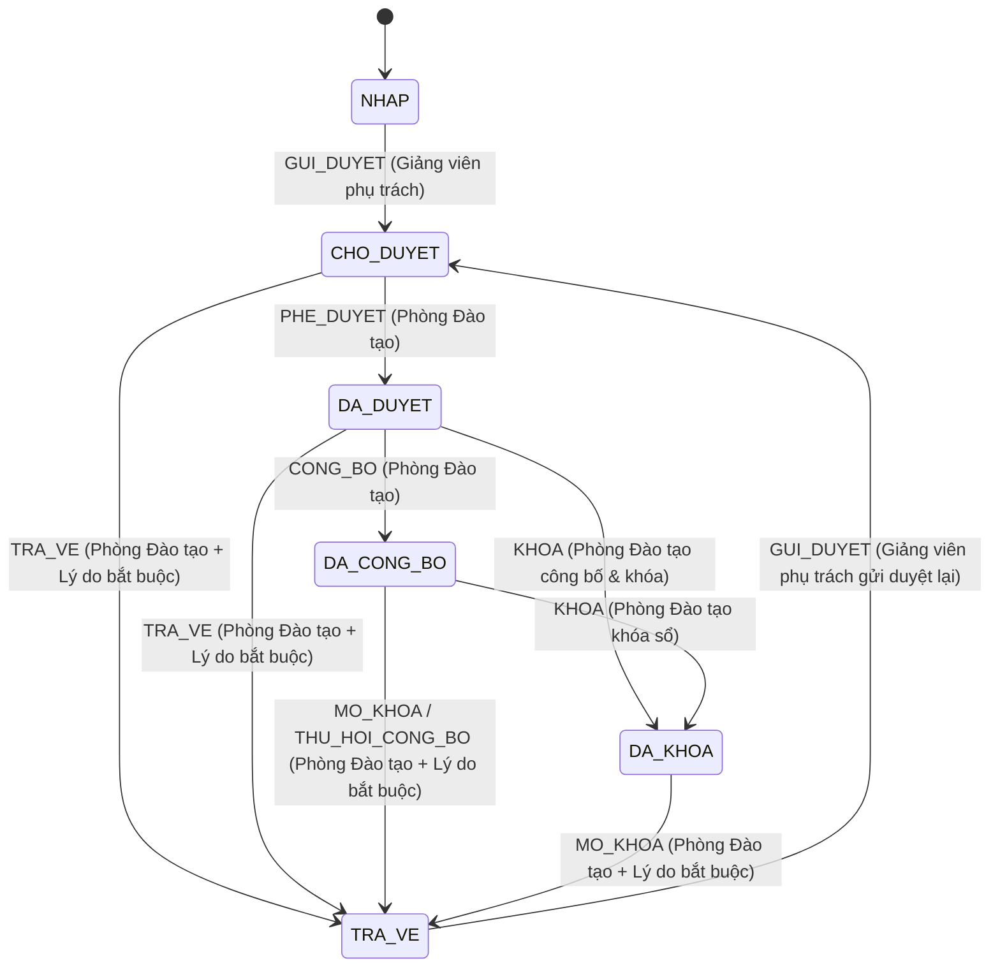

# Luồng Gửi duyệt, Phê duyệt, Trả về, Công bố và Khóa Bảng điểm (QLSV-74 / TASK-LC-09)

Tài liệu này mô tả chi tiết máy trạng thái (state machine), phân quyền (permission mapping), cơ chế khóa đồng thời (locking), kiểm toán (audit log) và phát sự kiện thông báo công bố điểm cho bảng điểm lớp học phần trong hệ thống Quản lý Đào tạo.

---

## 1. Máy trạng thái bảng điểm (State Machine)

Bảng điểm gắn với thực thể lớp học phần ([`CourseClass`](../backend/src/main/java/com/edu/registration/entity/CourseClass.java)) thông qua enum [`GradeSheetStatus`](../backend/src/main/java/com/edu/registration/entity/GradeSheetStatus.java). Client **không bao giờ** được truyền tên trạng thái tùy ý để cập nhật trực tiếp; mọi chuyển đổi trạng thái đều đi qua các hành động nghiệp vụ chuyên biệt trong [`GradeService`](../backend/src/main/java/com/edu/registration/service/GradeService.java).

### 1.1. Danh sách trạng thái (`GradeSheetStatus`)

| Mã trạng thái | Tên hiển thị | Cho phép sửa/import điểm (`isChoPhepSuaDiem`) | Sinh viên xem được điểm (`isDaCongBo`) | Đã khóa cứng (`isDaKhoa`) | Mô tả nghiệp vụ |
|---|---|---|---|---|---|
| `NHAP` | Bản nháp | Có | Không | Không | Trạng thái khởi tạo mặc định. Giảng viên phụ trách lớp nhập điểm từng dòng, lưu hàng loạt hoặc import từ `.xlsx`. |
| `CHO_DUYET` | Chờ duyệt | Không | Không | Không | Giảng viên phụ trách đã hoàn tất nhập điểm cho toàn bộ sinh viên đang học và gửi lên Phòng Đào tạo chờ xét duyệt. |
| `TRA_VE` | Trả về chỉnh sửa | Có | Không | Không | Phòng Đào tạo trả bảng điểm về kèm lý do bắt buộc (hoặc mở khóa bảng điểm kèm lý do bắt buộc) để giảng viên chỉnh sửa và gửi duyệt lại. |
| `DA_DUYET` | Đã duyệt | Không | Không | Không | Phòng Đào tạo đã phê duyệt bảng điểm, sẵn sàng để công bố hoặc khóa. |
| `DA_CONG_BO` | Đã công bố | Không | Có | Không | Bảng điểm đã được công bố chính thức cho sinh viên và phát thông báo nội bộ `GRADES_PUBLISHED`. |
| `DA_KHOA` | Đã khóa | Không | Có | Có | Bảng điểm đã công bố và khóa sổ cuối kỳ. Mọi chỉnh sửa bị chặn hoàn toàn trừ khi có thao tác mở khóa đặc biệt kèm lý do bắt buộc. |

### 1.2. Sơ đồ chuyển trạng thái hợp lệ

### 1.3. Bảng quy tắc chuyển trạng thái chi tiết

| Hành động (`hanhDong`) | Trạng thái trước hợp lệ | Trạng thái sau | Điều kiện tiên quyết | Lý do (`lyDo`) |
|---|---|---|---|---|
| `GUI_DUYET` | `NHAP`, `TRA_VE` | `CHO_DUYET` | Lớp có ít nhất 1 sinh viên `DA_DANG_KY` và 100% sinh viên đang học đã có đủ `diemQuaTrinh`, `diemCuoiKy`, `diemTongKet` hợp lệ (theo quy tắc QLSV-72). | Không bắt buộc |
| `TRA_VE` | `CHO_DUYET`, `DA_DUYET` | `TRA_VE` | Bảng điểm đang chờ duyệt hoặc đã duyệt nhưng chưa công bố/khóa. | **Bắt buộc** (`!lyDo.isBlank()`, tối đa 500 ký tự) |
| `PHE_DUYET` | `CHO_DUYET` | `DA_DUYET` | 100% sinh viên đang học trong lớp đã có đủ điểm hợp lệ. | Không bắt buộc |
| `CONG_BO` | `DA_DUYET` | `DA_CONG_BO` | Bảng điểm đã được phê duyệt (`DA_DUYET`) và 100% sinh viên đang học có đủ điểm hợp lệ. Tăng `phienBanCongBo`. | Không bắt buộc |
| `KHOA` | `DA_DUYET`, `DA_CONG_BO` | `DA_KHOA` | Bảng điểm đã duyệt hoặc đã công bố. Nếu khóa trực tiếp từ `DA_DUYET`, hệ thống đồng thời ghi nhận thời điểm công bố, tăng `phienBanCongBo` và phát sự kiện thông báo công bố sau khi commit. | Tùy chọn (mặc định: `"Khóa bảng điểm chính thức"`) |
| `MO_KHOA` (hoặc `THU_HOI_CONG_BO`) | `DA_CONG_BO`, `DA_KHOA` | `TRA_VE` | Chỉ thực hiện khi cần đính chính/phúc khảo sau khi đã công bố hoặc khóa. | **Bắt buộc** (`!lyDo.isBlank()`, tối đa 500 ký tự) |

Mọi yêu cầu chuyển trạng thái không nằm trong bảng trên đều bị từ chối ở tầng dịch vụ với mã lỗi `409 Conflict`.

---

## 2. Phân quyền (Permission Mapping) & Các vai trò chờ chốt

### 2.1. Ánh xạ quyền trên mô hình `Role` hiện hữu

Hệ thống hiện định nghĩa 3 vai trò trong [`Role.java`](../backend/src/main/java/com/edu/registration/entity/Role.java): `SINH_VIEN`, `GIANG_VIEN`, `QUAN_TRI`. Theo đúng nguyên tắc bảo mật tối thiểu (không tự cấp quyền duyệt/khóa/mở khóa cho giảng viên hoặc role bất kỳ):

| Thao tác nghiệp vụ | Endpoint chính | Vai trò được phép | Kiểm tra bổ sung ở Backend |
|---|---|---|---|
| Nhập/sửa điểm đơn lẻ, lưu hàng loạt | `PUT /api/diem/{dangKyId}` `PUT /api/giang-vien/lop-hoc-phan/{id}/diem` | `GIANG_VIEN` (chính giảng viên phụ trách lớp) | Trạng thái bảng điểm phải là `NHAP` hoặc `TRA_VE` (`lop.isChoPhepSuaDiem() == true`). Các trạng thái `CHO_DUYET`, `DA_DUYET`, `DA_CONG_BO`, `DA_KHOA` đều bị chặn `409 Conflict`. |
| Tải mẫu & Import điểm từ `.xlsx` (QLSV-73) | `GET .../diem/template-xlsx` `POST .../diem/import-xlsx/preview` `POST .../diem/import-xlsx/confirm` | `GIANG_VIEN` (chính giảng viên phụ trách lớp) | Kiểm tra quyền sở hữu lớp và `kiemTraBangDiemChoPhepSua(lop)` ở cả bước `preview` lẫn `confirm`. |
| Gửi duyệt / Gửi duyệt lại (`GUI_DUYET`) | `POST /api/giang-vien/lop-hoc-phan/{id}/gui-duyet-diem` | `GIANG_VIEN` (chính giảng viên phụ trách lớp) | Quản trị viên hoặc giảng viên không phụ trách lớp gọi API sẽ nhận `403 Forbidden`. |
| Phê duyệt (`PHE_DUYET`) | `POST /api/admin/lop-hoc-phan/{id}/phe-duyet-diem` | `QUAN_TRI` (Phòng Đào tạo) | Giảng viên gọi API sẽ nhận `403 Forbidden`. |
| Trả về chỉnh sửa (`TRA_VE`) | `POST /api/admin/lop-hoc-phan/{id}/tra-ve-diem` | `QUAN_TRI` (Phòng Đào tạo) | Bắt buộc có `lyDo` không rỗng (`400 Bad Request` nếu thiếu). |
| Công bố (`CONG_BO`) | `POST /api/admin/lop-hoc-phan/{id}/cong-bo-diem` | `QUAN_TRI` (Phòng Đào tạo) | Giảng viên gọi API sẽ nhận `403 Forbidden`. |
| Khóa bảng điểm (`KHOA`) | `POST /api/admin/lop-hoc-phan/{id}/khoa-diem` | `QUAN_TRI` (Phòng Đào tạo) | Giảng viên gọi API sẽ nhận `403 Forbidden`. |
| Mở khóa bảng điểm (`MO_KHOA`) | `POST /api/admin/lop-hoc-phan/{id}/mo-khoa-diem` | `QUAN_TRI` (Phòng Đào tạo) | Bắt buộc có `lyDo` không rỗng (`400 Bad Request` nếu thiếu). |
| Xem bảng điểm & lịch sử trạng thái | `GET /api/giang-vien/lop-hoc-phan/{id}/lich-su-bang-diem` `GET /api/admin/lop-hoc-phan/{id}/lich-su-bang-diem` | `GIANG_VIEN` (lớp mình dạy) hoặc `QUAN_TRI` | Giảng viên khác không phụ trách lớp nhận `403 Forbidden`. |
| Sinh viên xem điểm học tập | `GET /api/sinh-vien/me/diem` `GET /api/sinh-vien/me/lich-su-hoc-tap` | `SINH_VIEN` (chính sinh viên đăng nhập) | Chỉ trả điểm của lớp có trạng thái `DA_CONG_BO` hoặc `DA_KHOA`. Các trạng thái `NHAP`, `CHO_DUYET`, `TRA_VE`, `DA_DUYET` đều ẩn điểm. |

### 2.2. Các điểm cần chủ dự án chốt thêm về vai trò chi tiết của Phòng Đào tạo

Hiện tại dự án chưa tách nhỏ các role nội bộ của Phòng Đào tạo / Khoa. Do đó toàn bộ quyền **Phê duyệt**, **Trả về chỉnh sửa**, **Công bố**, **Khóa** và **Mở khóa đặc biệt** đang được ánh xạ chặt chẽ vào `Role.QUAN_TRI` hiện hữu (không tự ý mở cho `Role.GIANG_VIEN`). Khi dự án mở rộng RBAC chi tiết, cần chốt thêm:
1. Có tách riêng vai trò **Chuyên viên khảo thí / Giáo vụ duyệt điểm** (`GIAO_VU` / `KHAO_THI`) với vai trò **Trưởng phòng Đào tạo** (`TRUONG_PHONG_DAO_TAO`) chỉ chuyên trách thao tác **Mở khóa (`MO_KHOA`)** sau khi đã khóa sổ hay không?
2. Trưởng bộ môn / Trưởng khoa có tham gia bước sơ duyệt trước khi chuyển lên Phòng Đào tạo hay không?

---

## 3. Khóa đồng thời (Concurrency Control), Lịch sử chuyển trạng thái & Audit Log

### 3.1. Chống ghi đè khi hai luồng duyệt đồng thời
- Mọi thao tác chuyển trạng thái (`guiDuyetBangDiem`, `traVeBangDiem`, `pheDuyetBangDiem`, `congBoBangDiem`, `khoaBangDiem`, `moKhoaBangDiem`) và cập nhật điểm hàng loạt / xác nhận import `.xlsx` đều chạy trong `@Transactional` và khóa bản ghi `CourseClass` bằng `lopHocPhanRepository.findByIdForUpdate(lopHocPhanId)` (`@Lock(LockModeType.PESSIMISTIC_WRITE)` — `SELECT ... FOR UPDATE`).
- Mỗi lần chuyển trạng thái hợp lệ, bộ đếm `phienBanBangDiem` trên `CourseClass` tự động tăng thêm 1 (`lop.tangPhienBanBangDiem()`).
- Khi hai luồng đồng thời cùng gửi yêu cầu duyệt hoặc duyệt/trả về trên một bảng điểm `CHO_DUYET`, luồng thứ hai sẽ phải đợi khóa DB giải phóng, đọc thấy trạng thái mới nhất sau khi luồng thứ nhất đã commit và bị chặn theo đúng quy tắc máy trạng thái (`409 Conflict` nếu trạng thái không còn hợp lệ).

### 3.2. Lưu vết lịch sử chuyển trạng thái (`GradeSheetStateHistory`) & Audit Log (`AuditLogService`)
- Mỗi lần chuyển trạng thái sẽ lưu một bản ghi bất biến vào bảng `lich_su_trang_thai_bang_diem` ([`GradeSheetStateHistory`](../backend/src/main/java/com/edu/registration/entity/GradeSheetStateHistory.java)) gồm:
  - `lop_hoc_phan_id`, `hanh_dong`, `trang_thai_truoc`, `trang_thai_sau`, `ly_do`, `nguoi_thuc_hien_id`, `nguoi_thuc_hien_username`, `nguoi_thuc_hien_role`, `thoi_diem`.
- Đồng thời ghi nhận sự kiện vào nhật ký kiểm toán hệ thống (`audit_log`) với `entityType = "GRADE_SHEET"` và các mã hành động:
  - `GRADE_SHEET_SUBMITTED` (Gửi duyệt)
  - `GRADE_SHEET_RETURNED` (Trả về chỉnh sửa kèm lý do)
  - `GRADE_SHEET_APPROVED` (Phê duyệt)
  - `GRADE_SHEET_PUBLISHED` (Công bố)
  - `GRADE_SHEET_LOCKED` (Khóa bảng điểm)
  - `GRADE_SHEET_UNLOCKED` (Mở khóa bảng điểm kèm lý do)

---

## 4. Tích hợp Thông báo Công bố Điểm sau Commit (QLSV-65)

- Khi bảng điểm chuyển sang trạng thái công bố (`DA_CONG_BO`, hoặc công bố kết hợp khóa trực tiếp từ `DA_DUYET` sang `DA_KHOA`), [`GradeService`](../backend/src/main/java/com/edu/registration/service/GradeService.java) tăng `phienBanCongBo` và gọi [`NotificationService.gradesPublished(...)`](../backend/src/main/java/com/edu/registration/service/NotificationService.java).
- Bên trong `NotificationService`, việc phát thông báo được đăng ký qua `TransactionSynchronizationManager.registerSynchronization(new TransactionSynchronization() { public void afterCommit() { ... } })` và thực thi trong `TransactionTemplate(PROPAGATION_REQUIRES_NEW)`.
- Nhờ đó:
  1. Tuyệt đối **không gửi thông báo** khi bảng điểm đang ở `NHAP`, `CHO_DUYET`, `TRA_VE`, `DA_DUYET`, hoặc nếu giao dịch công bố bị rollback.
  2. Khóa idempotency `GRADES_PUBLISHED:class:{id}:v{phienBanCongBo}` đảm bảo mỗi sinh viên đang đăng ký học phần chỉ nhận thông báo đúng một lần cho mỗi phiên bản công bố.
