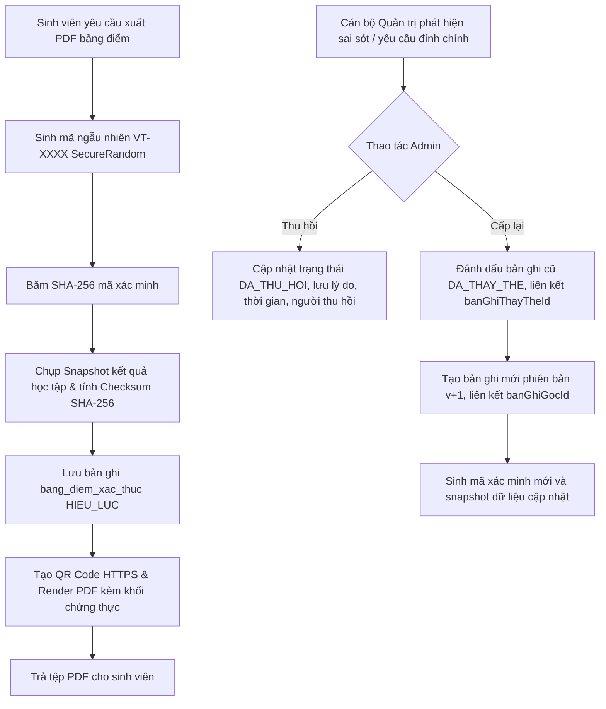

# Bảng điểm điện tử xác thực (QLSV-99 / TASK-OP-12)

Tài liệu thiết kế, bảo mật, vận hành và API cho tính năng **Bảng điểm điện tử xác thực** trong dự án Quản lý sinh viên (QLSV).

---

## 1. Tổng quan kiến trúc & Mục tiêu

Tính năng cho phép sinh viên xuất bảng điểm điện tử có chứng thực số, gắn mã xác minh ngẫu nhiên entropy cao và mã phản hồi nhanh (QR Code). Bất kỳ bên thứ ba (nhà tuyển dụng, trường liên kết, cơ quan nhà nước) đều có thể quét mã QR hoặc nhập mã xác minh để đối soát tính hợp lệ của văn bản mà không xâm phạm quyền riêng tư dữ liệu học tập của sinh viên.

### Nguyên tắc bảo mật cốt lõi:
1. **Mã xác minh entropy cao**: Tạo bằng `java.security.SecureRandom` với hơn 160 bits entropy thực tế. Không sử dụng ID tự tăng, mã tuần tự hay thông tin suy đoán được.
2. **Lưu trữ một chiều (One-way Hash)**: Token xác minh gốc chỉ xuất hiện một lần duy nhất trên bản in PDF trả về cho người học. Cơ sở dữ liệu chỉ lưu chuỗi băm `SHA-256` (`ma_xac_minh_hash`), bảo vệ mã kể cả khi cơ sở dữ liệu bị rò rỉ.
3. **Không ghi token bí mật vào log**: Mọi bản ghi hệ thống (Logback, Audit Log, exception handlers) chỉ ghi nhận mã đã che (`maskCode`) hoặc ID bản ghi; tuyệt đối không đưa chuỗi token xác minh thô vào log.
4. **Bất biến snapshot (Immutable Snapshot)**: Tại thời điểm phát hành, toàn bộ dữ liệu bảng điểm được đóng băng dưới dạng JSON và tính mã băm toàn vẹn `SHA-256 Checksum`. Các thay đổi điểm số phát sinh sau đó trong hệ thống không làm thay đổi nội dung của phiên bản đã cấp.
5. **Chính sách công khai tối thiểu (Minimal Disclosure Policy)**: Endpoint công khai chỉ trả về thông tin định danh tối thiểu (MSSV, Họ tên, Khoa, Ngành, Lớp, Niên khóa) và các chỉ số tích lũy tổng hợp (Số môn công bố, Tín chỉ tích lũy, GPA thang 10 & thang 4). **Tuyệt đối không công khai bảng điểm chi tiết từng môn** trừ khi có ủy quyền hoặc đăng nhập hợp lệ.
6. **Bảo vệ quyền riêng tư khi tra cứu mã lỗi/thu hồi**: Mã sai hoặc văn bản đã bị thu hồi/thay thế sẽ không tiết lộ bất kỳ thông tin cá nhân nào (MSSV, Họ tên để `null`).
7. **Chống dò quét & Rate Limiting**: Endpoint công khai `/api/public/bang-diem/xac-thuc/**` được giới hạn tốc độ nghiêm ngặt (mặc định 20 lượt / 60 giây theo IP) bằng Bucket4j/In-memory token bucket.

---

## 2. Quy trình Cấp phát, Thu hồi & Cấp lại



### Chi tiết các trạng thái:
- `HIEU_LUC`: Bảng điểm có giá trị xác thực đầy đủ. Endpoint công khai trả về thông tin xác thực kèm các chỉ số học tập.
- `DA_THU_HOI`: Bảng điểm bị hủy bỏ hiệu lực (do phát hiện gian lận, sai sót dữ liệu, vi phạm học vụ). Trang xác minh công khai hiển thị cảnh báo đỏ và lý do thu hồi, che giấu hoàn toàn thông tin cá nhân.
- `DA_THAY_THE`: Bảng điểm đã được cấp lại phiên bản mới hơn (v+1). Trang xác minh cảnh báo bản in đã cũ và hướng dẫn sử dụng bản in mới nhất.

---

## 3. Cấu hình Vận hành (`application.yml`)

```yaml
app:
  verifiable-transcript:
    enabled: true
    verification-base-url: "https://daotao.edu.vn" # Cấu hình domain theo môi trường
    max-public-lookup-per-minute: 20
    qr-code-size: 150
```

---

## 4. Danh mục API

### 4.1. Dành cho công chúng (Không cần đăng nhập)
- **`GET /api/public/bang-diem/xac-thuc/{maXacMinh}`**
  - Giới hạn tốc độ: 20 requests / 60s per IP.
  - Phản hồi mã hợp lệ: Trả về HTTP 200, thông tin sinh viên, chỉ số học tập tổng hợp, checksum SHA-256, phiên bản.
  - Phản hồi mã không hợp lệ / không tìm thấy: Trả về HTTP 200 với `trangThaiXacMinh: "KHONG_HOP_LE"`, `hopLe: false`, không có thông tin cá nhân.
  - Phản hồi mã thu hồi: Trả về HTTP 200 với `trangThaiXacMinh: "DA_THU_HOI"`, `hopLe: false`, có thời gian thu hồi & lý do, không có thông tin cá nhân.

### 4.2. Dành cho sinh viên (ROLE: `SINH_VIEN`)
- **`GET /api/sinh-vien/me/bang-diem/pdf?hocKyId={id}`**
  - Tự động cấp bản ghi bảng điểm xác thực nếu tính năng được bật (`app.verifiable-transcript.enabled: true`).
  - Gắn mã xác minh và mã QR HTTPS vào PDF.
  - Trả về header: `X-Verification-Code`, `X-Verification-Url`, `X-Transcript-Version`.
- **`GET /api/sinh-vien/me/bang-diem-xac-thuc`**
  - Xem lịch sử các bảng điểm điện tử đã phát hành của cá nhân.
- **`GET /api/sinh-vien/me/bang-diem-xac-thuc/{id}/pdf`**
  - Tải lại tệp PDF của bản ghi xác thực đã phát hành (bảo toàn theo snapshot bất biến).

### 4.3. Dành cho quản trị viên (ROLE: `QUAN_TRI`)
- **`GET /api/admin/bang-diem-xac-thuc`**: Phân trang danh sách bảng điểm xác thực, lọc theo mã sinh viên, học kỳ, trạng thái.
- **`GET /api/admin/bang-diem-xac-thuc/{id}`**: Xem chi tiết bản ghi, mã băm, snapshot dữ liệu và cây liên kết phiên bản.
- **`GET /api/admin/bang-diem-xac-thuc/{id}/pdf`**: Tải bản PDF đã cấp phát.
- **`POST /api/admin/bang-diem-xac-thuc/{id}/thu-hoi`**: Thu hồi bảng điểm (bắt buộc truyền `lyDo`).
- **`POST /api/admin/bang-diem-xac-thuc/{id}/cap-lai`**: Cấp lại bảng điểm phiên bản mới (bắt buộc truyền `lyDo`).

---

## 5. Kiểm thử & Đảm bảo chất lượng

1. **`VerifiableCodeSupportTest`**: Kiểm tra entropy mã, tính chuẩn hóa khoảng trắng/gạch nối, cơ chế băm SHA-256 và sinh mã QR PNG.
2. **`VerifiableTranscriptServiceTest`**: Kiểm thử phát hành, bất biến snapshot, thu hồi, cấp lại, bảo mật thông tin cá nhân.
3. **`VerifiableTranscriptIntegrationTest`**: Kiểm thử luồng tích hợp hoàn chỉnh qua MockMvc: từ xuất PDF có QR, tra cứu công khai không cần auth, giới hạn tốc độ rate limit, phân quyền RBAC và thu hồi/cấp lại.
